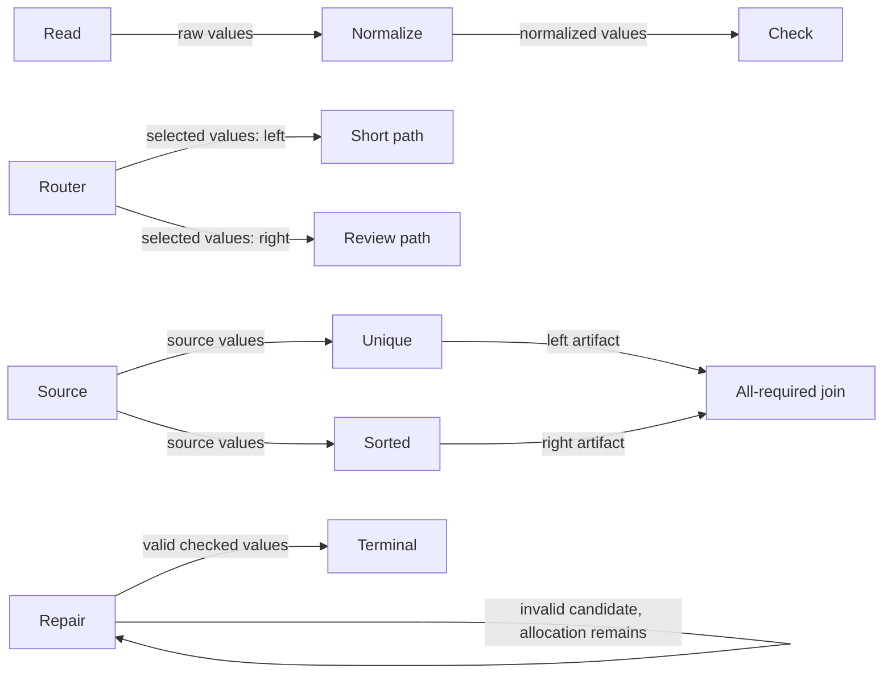

# Graphs, Checkpoints, and Effects

## Four Shapes

- Every edge names its artifact and condition. Keep real data, resource, write-ownership, and policy dependencies. Remove accidental ordering only after checking shared resource and ownership conflicts.
- Validate unique node IDs, schemas, required inputs, allowed transitions, reachable terminals, finite total steps and visits, and explicit join dependencies. A schema match is an edge-level check; semantic acceptance can require a separate verifier.
- Route from structured state in code. If a model proposes a route, compare it with the node's declared transitions before dispatch. Never execute arbitrary generated workflow code without validating the workflow and its permissions.

The runnable graph examples show a chain, both router paths, a fan-out, and a bounded cycle with named payloads. They demonstrate orchestration contracts using deterministic code. The loop example separately demonstrates independent behavioral verification. Graph fixture success means selected transitions and schemas passed; it does not establish real task or provider quality.

## Join and Failure Policy

Choose all branches, quorum, first valid result, or all settled results explicitly before execution. Define the threshold and cancellation of unused work. The reference supports only all-required joins: every dependency and its typed artifact must arrive. Missing outputs, a timeout, invalid output, cancellation, or a failed required branch prevents success. Partial outputs remain available for inspection and cannot enter a successful downstream join. Quorum and first-valid semantics require separate reviewed implementations.

Repair only a failed unit; preserve verified sibling outputs and invalidate downstream evidence. Real schedulers should model ordering edges separately from resource/write ownership locks. This reference schedules sequentially and keeps a single controller writer, avoiding shared-write races without claiming parallel scheduling.

## Resume and Effects

1. Persist graph version, contract and handler identity, revision, queue, outputs and digests, visits, steps, deadline, and trace. Resume only when schemas, artifact digests, contract, revision, and executor policy remain compatible. Contract versions must change when acceptance or graph semantics change.
2. Use atomic writes and one owner. Recover corrupt/incomplete checkpoints by preserving them, inspecting the last trustworthy artifact and evidence, and starting a reviewed run. Do not silently skip nodes or turn partial joins into success. Locks survive crashes and require explicit owner reconciliation.
3. Reserve allocation before a node runs. A crash may replay an unfinished node; do not refund the reservation. Code nodes must be pure or idempotent. External actions need service idempotency keys or explicit reconciliation for a crash after the effect but before its completion record.
4. Place required approval before the unapproved effect and bind it to the exact reviewed artifact. Changed artifacts invalidate approval. Do not claim exactly-once execution from a local completion log.
5. Prefer versioned stable graphs for recurring work. A generated one-off graph must pass schema, dependency, permission, resource, and effect checks before execution.

The local effect fixture writes one digest-bound local artifact per idempotency key, then a separate receipt. A duplicate key with different content requires reconciliation. The root must have one owner. This illustrates the crash window without authorizing an external effect.
